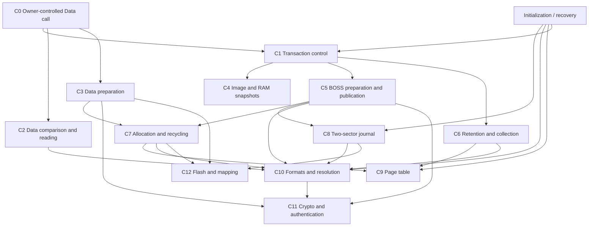

# Registry components, contracts, and bindings

The [public contract](theories/interface/OwnedDataContract.v) separates required
laws, entry conditions, executions, and offered guarantees. The
[concrete binding](theories/composition/OwnedDataBinding.v) interprets each field
using the registry model. The [component proof](theories/composition/OwnedDataComponent.v)
consumes `owned_calls_from_idle` to establish that signature.

This map identifies existing definitions and Rust boundaries. It does not create
new Rust modules or claim that a manual correspondence is a mechanized refinement.
The identifiers C0–C12 and L01–L24 name components and binding obligations.

## Reading a component contract

An offered service has a typed interface, a witness state, caller obligations,
permitted responses, and a witness update. A component uses required services
under their contracts. Its proof derives its own caller obligations and offered
guarantees from those supplier guarantees. A binding then substitutes a verified
supplier implementation for the abstract service.

Ghost certificates and history are proof information, not firmware RAM.
Reset and Fatal are not ordinary returns. A returned error may retain physical
effects. Bindings must preserve these distinctions.

Status labels distinguish composition from implementation:

- **M:** the contract is consumed and composition is proved within the stated model scope.
- **P:** the software supplier's implementation proof remains open.
- **H:** an accepted physical/cryptographic assumption or configuration constraint.
- **X:** outside the owner-controlled Data slice or not yet composed generally.

Rust boundaries are **direct** when a module's functions/types identify them,
**distributed** when several modules or private helpers implement them, and
**absent** when no standalone interface exists. None implies a completed Rust
refinement. A Rust component boundary need not be a `trait`.

## Dependency map

Arrows run from client to supplier. This is a functional map, not an import graph.
The journal requires a BOSS validator, not the complete publisher; it does not
assume that its candidate is already published.

## Component interfaces

### C0 — Owner-controlled Data update service

**Offers:** zero/one/two selected modifications, repeated-tag handling, and
success/error delivery or interruption. An unchanged success creates no
publication; a publication without return creates no client receipt.
**Requires:** C1–C3, prepass/identity services, an initialized entry without an
active parent or LOAD, and the configured entry invariant. Modeled entry
rejections are results, not arbitrarily excluded errors.

**Rocq:** [OwnedDataContract.v](theories/interface/OwnedDataContract.v),
[OwnedDataServices.v](theories/registry/semantics/OwnedDataServices.v),
`PairPrepassAPI/pair_prepass_contract` in
[FreerGlobalDataTrace.v](theories/internal/transactions/FreerGlobalDataTrace.v),
and `owned_calls_from_idle` in
[FreerRecycledWriter.v](theories/internal/transactions/FreerRecycledWriter.v).
**Rust, distributed:** [selected_app.rs](../../kernel/firmware/src/selected_app.rs),
`write_registry_data_objects` and `registry_operation`.
**Status M/P/X:** composition is proved under contracts. The signature covers
this slice, not every public registry service. Callback-byte semantics remain
linked to C2/C3 by obligations still to discharge.

### C1 — Control, ownership, scopes, and delivery

**Offers:** begin, sticky abort, Retained/Aborted finalization, rollback, handle
consumption, freeze, and delivery distinct from publication.
**Requires:** C4 prestates, C5 publication/restoration, C6 closure/collection,
and serialized calls and accesses to shared state.

**Rocq:** `ControllerAPI/controller_contract` and `RestoreAPI/restore_contract` in
[FreerGlobalDataTrace.v](theories/internal/transactions/FreerGlobalDataTrace.v),
`ClientFinishAPI/client_finish_contract` in
[FreerPublicationReturn.v](theories/internal/transactions/FreerPublicationReturn.v),
and [TransactionBoundary.v](theories/internal/transactions/TransactionBoundary.v).
**Rust, distributed:** [transaction.rs](../../kernel/firmware/src/registry/transaction.rs),
`begin_transaction`, `request_abort`, `commit_transaction_with`,
`rollback_transaction`, `run_operation`, `TransactionOwner::drop`;
[savepoint.rs](../../kernel/firmware/src/registry/savepoint.rs), `OperationScope`
and `RollbackObserver`.
**Status M/X:** owner control is covered; general joined callers with active
parents and all callbacks are not. APDU status adaptation is a separate client
boundary.

### C2 — Data reading and comparison

**Offers:** fragment reads and comparison against requested contents. An equal
response must justify returning without writing.
**Requires:** C10 references/ranges, C12 reads, and C11 decryption/validation.

**Rocq:** `PairCompare` consumes `compare : nat -> option bool`;
[CompactProjection.v](theories/common/CompactProjection.v) supplies partial logical
resolution, not a complete encrypted Data reader API.
**Rust, distributed:** [content.rs](../../kernel/firmware/src/registry/content.rs),
`Content::read_range/matches_generated`;
[objects.rs](../../kernel/firmware/src/registry/objects.rs),
`ObjectView::data_matches_generated`;
[data_crypto.rs](../../kernel/firmware/src/registry/data_crypto.rs), `DataRef`.
**Status P:** establish byte equality and justify `FnMut` callback behavior
between comparison and writing.

### C3 — Data preparation and reservation token

**Offers:** write into a reservation and return a token consumed at attachment;
retain reached flash and follow actual cleanup/freeze on error. Locality is not
write atomicity.
**Requires:** C7 for an admissible, erased reservation; C10/C11 for bytes;
C12 for programming; C9/C6 for permitted release.

**Rocq:** `writer_execution` in
[PreparationOutcomes.v](theories/internal/transactions/PreparationOutcomes.v),
`pending_writer_run`, `argument_plan`, `consume_pending`, and the marked body;
`DataAPI/data_contract` and `ExactImageAPI/exact_contract` in
[FreerPrepared.v](theories/internal/transactions/FreerPrepared.v).
**Rust:** [payload.rs](../../kernel/firmware/src/registry/payload.rs),
`prepare_data_payload`, `DataReservation`;
[operations.rs](../../kernel/firmware/src/registry/operations.rs),
`Mutation::attach_prepared_data_object` and registry internals.
**Status M/P:** token lifecycle and transactional effects are composed; callback
to plan to recovered bytes, and individual command refinement, remain open.

### C4 — Compact image and snapshot stack

**Offers:** exact replacement, preservation of other slots, last-occurrence
priority, begin/accept/rollback, and deferred-root sharing.
**Requires:** C10 identity/resolution; C5 to materialize a `None` root;
C9/C6 for range ownership.

**Rocq:** [CompactImage.v](theories/common/CompactImage.v),
[CompactUpdates.v](theories/common/CompactUpdates.v),
[DeferredSnapshots.v](theories/common/DeferredSnapshots.v),
[ScopeOwnership.v](theories/internal/allocation/ScopeOwnership.v),
`SnapshotAPI/snapshot_contract`, `ExactImageAPI/exact_contract`.
**Rust, direct:** [image.rs](../../kernel/firmware/src/registry/image.rs),
`Image`, `Entry`, `Address`;
[snapshots.rs](../../kernel/firmware/src/registry/snapshots.rs), `Snapshots`.
**Status M/P/X:** pure lemmas and owner-path correspondences are consumed.
Byte-level Rust refinement and general nested physical snapshots remain separate
from the owner slice with `Some` roots.

### C5 — BOSS snapshots and publication

**Offers:** prepare a BOSS matching the image and generation; rehome, cache,
set generation, construct the address, install, validate before append, publish,
synchronize runtime, close, and deliver. A written snapshot is not yet published.
**Requires:** C4, C7, C10, C11, C12, C8, and C6; delivery belongs to C1.

**Rocq:** `boss_generation_format` in
[BossEncodingContract.v](theories/suppliers/BossEncodingContract.v),
`CandidateAPI/candidate_contract`, `PublicationExitAPI/exit_contract`,
`BossCheckAPI/boss_check_contract` in
[FreerPreAppend.v](theories/internal/transactions/FreerPreAppend.v),
`boss_check_provider` in [BossValidationContract.v](theories/suppliers/BossValidationContract.v),
and `owned_entry_marked_recycling`.
**Rust, direct with suppliers:** [publication.rs](../../kernel/firmware/src/registry/publication.rs),
`write_snapshot`, `with_snapshot`, `restore_snapshot`,
`publish_persistent_registry_after_mutation`, `ensure_protection`.
**Status M/P:** composition is established; encoding, reading/validation, and
configuration contracts are parameters, not verified implementations.

### C6 — Live roots, retention, and collection

**Offers:** enumerate needed ranges, close owners, install the mask or skip
collection under its guards, and protect possible authorities after uncertain
publication. Freeze prohibits releases.
**Requires:** C4/C5/C8 roots, C10 resolution, C9 table, and C1 control state.

**Rocq:** [CollectionRoots.v](theories/internal/allocation/CollectionRoots.v),
[RetentionCoverage.v](theories/internal/allocation/RetentionCoverage.v),
`CollectionAPI/collection_contract`, and `collection_return`.
`CollectScratch` requires its returned mask to equal `collect_ranges`.
**Rust, distributed:** [retention.rs](../../kernel/firmware/src/registry/retention.rs),
`visit_live`, `ScopeRelease`, `collect`, `release_unattached`, private helpers
`roots`, `root_range`, `entry_range`, and `publication::with_snapshot`.
**Status M/P/X:** protection after mask installation is proved. Concrete
enumeration/resolution completeness and executed LOAD remain separate obligations.

### C7 — Allocation, neutralization, and recycling

**Offers:** probe/fallback, candidate selection, neutralization, erasure, cursor
advance, then one late reservation. Retain partial effects, freeze, and resets.
Failure to find an erased range does not imply lack of recyclable capacity.
**Requires:** C9 freedom checks, C10 recognition, C12 flash, C1 control, and
C8/C5 durable-root provenance for the search origin.

**Rocq:** `CursorAPI/cursor_contract` in
[FreerAllocationAdmission.v](theories/internal/allocation/FreerAllocationAdmission.v),
`RecyclingAPI/recycling_contract` in
[FreerRecyclingSearch.v](theories/internal/allocation/FreerRecyclingSearch.v),
`NeutralAPI`, `RecycleAPI`, `LateReserveAPI` in
[FreerNeutralization.v](theories/internal/allocation/FreerNeutralization.v) and
[FreerRecyclingErase.v](theories/internal/allocation/FreerRecyclingErase.v).
**Rust, distributed:** [storage.rs](../../kernel/firmware/src/registry/storage.rs),
`reserve_persistent_span_sized` and private neutralization/erase helpers;
[format.rs](../../kernel/firmware/src/registry/format.rs),
`erased_span_at`, `find_reusable_span_sized_from`, `neutralize_recycled_blocks`.
**Status M/P:** protocol composition is proved. Recognition, concrete arithmetic,
and command correspondence remain to be implemented/proved. No availability or
termination guarantee is offered.

### C8 — Persistent journal authority

**Offers:** append, latest selection, rotation/recovery, address-complement
encoding, physical freshness, and preservation through cuts/errors/freeze.
Append acknowledgement is distinct from a delivered client receipt.
**Requires:** C12, geometry, a C10 BOSS validator, and C1/storage freeze policy.

**Rocq:** [JournalComplement.v](theories/internal/journal/JournalComplement.v),
[JournalReachableShape.v](theories/internal/journal/JournalReachableShape.v),
[JournalHistory.v](theories/internal/journal/JournalHistory.v),
[JournalRawOrder.v](theories/internal/journal/JournalRawOrder.v),
[FreerJournalAppend.v](theories/internal/journal/FreerJournalAppend.v),
`JournalGateAPI/gate_contract`.
**Rust, direct:** [journal.rs](../../kernel/firmware/src/registry/journal.rs),
`initialize`, `latest`, `append`, and private `validate`, `write_entry`, `latest_in`.
**Status M/P:** journal composition is consumed. Operational relations and local
programs coexist; not every rotation is translated into one complete FreerDPS
program. Validator/decoder consistency and Rust refinement remain obligations.

### C9 — Merged page table

**Offers:** reserve/release/rehome, scope transfer or release, collection,
authentication/invalidation, and checks before mutation.
**Requires:** geometry, initialization, numeric ranges, and a C6 mask for safe
collection. The table alone does not know all roots.

**Rocq:** [PageOwnership.v](theories/common/PageOwnership.v),
[PageSummaries.v](theories/internal/allocation/PageSummaries.v),
`ScopePagesAPI/scope_pages_contract`, `LateReserveAPI/late_contract`,
and [PreparedAuthority.v](theories/internal/transactions/PreparedAuthority.v).
**Rust, direct:** [pages.rs](../../kernel/firmware/src/registry/pages.rs),
`Pages::{reset,reserve,release,rehome,finish_scope,collect,authenticated,authenticate}`.
**Status M/P:** abstract algorithms and ownership/numeric transport are proved;
the four-bit representation, summaries, and concrete updates require refinement.

### C10 — Formats, BOSS reading, identities, and resolution

**Offers:** encode/decode, determine sizes/references, check structures, convert
addresses, and provide round-trip, bounds, and locality properties.
**Requires:** C11, C12 bytes, configuration, and C4 compact contents.

**Contract modules:**

| File | Definitions and dependencies |
| --- | --- |
| [BossDecodingContract.v](theories/suppliers/BossDecodingContract.v) | `generation_decoding_matches`, `generation_decoding_local`, `decoding_address_contract`, `validator_accepts_decoded`; common flash, parametric decoder and validator |
| [DecodedGeometryContract.v](theories/suppliers/DecodedGeometryContract.v) | `decoded_numeric_contract`, `decoded_allocation_geometry`, numeric checks over decoded ranges; bounds alone grant no release permission |
| [IncarnationReaderContract.v](theories/suppliers/IncarnationReaderContract.v) | `incarnation_reader_local` over existing certificates; resolved ranges and preserved bytes required |
| [BossEncodingContract.v](theories/suppliers/BossEncodingContract.v) | `boss_generation_format` over a writer plan and completed execution; no publication assumed |
| [BossValidationContract.v](theories/suppliers/BossValidationContract.v) | `boss_check_provider`, observations and responses; crypto errors permitted |

`recognizer_local` is defined in
[Neutralization.v](theories/internal/allocation/Neutralization.v). Operational
programs use these laws; logical decoders are not infallible concrete calls.

**Rust, distributed:** [format.rs](../../kernel/firmware/src/registry/format.rs),
`decode_registry_block_at/trusted/known`, `decrypt_registry_image`,
`decode_object_block_at/trusted`, and private recognition;
`Image::encode/restore`, [references.rs](../../kernel/firmware/src/registry/references.rs),
[recovery.rs](../../kernel/firmware/src/registry/recovery.rs), `entry_for_view/open_entry`,
and retention helpers.
**Status P with M algorithms:** this is a family of local suppliers, not one
monolithic interface. Distinguish total logical validation from fallible
concrete reading and crypto services.

### C11 — Cryptography, seeds, and authentication cache

**Offers:** derivation/IVs, encryption/decryption, tags/verification, and cache
management. Functional correctness and probabilistic security are distinct.
**Requires:** suitable keys/configuration, seed generation, oxi-core primitives,
C9 cache state, and format definitions of authenticated bytes.

**Rocq:** no standalone `CryptoAPI` equivalent to `FlashAPI` is implemented.
Current guarantees appear in C10 parameters and error/stop results.
**Rust, distributed:** [data_crypto.rs](../../kernel/firmware/src/registry/data_crypto.rs),
[boss_crypto.rs](../../kernel/firmware/src/registry/boss_crypto.rs),
[header_auth.rs](../../kernel/firmware/src/registry/header_auth.rs), and
[core/crypto.rs](../../kernel/core/src/core/crypto.rs), including
`aes_cbc_encrypt_in_place`, `aes_cbc_decrypt_range_into`,
`aes_ecb_encrypt_in_place`, and `aes_cmac_parts`.
**Status P/H:** separate concrete suppliers before adopting any single “secure
crypto” assumption. No global probabilistic theorem is established.

### C12 — Physical flash and address mapping

**Offers:** faithful reads, synchronous programming/erasure, errors with allowed
effects, reset without continuation, and locality outside the target range.
**Caller:** alignment, bounds, size, and permitted 1→0 programming.
**Requires:** the oxi-core backend and accepted physical assumptions.

**Rocq:** [FlashSpec.v](theories/suppliers/FlashSpec.v),
`FlashAPI/flash_contract`, `interrupted_flash_call` in
[FreerFlash.v](theories/suppliers/FreerFlash.v).
**Rust, direct with adapter:** [physical.rs](../../kernel/firmware/src/registry/physical.rs),
`read_area`, `read_journal`, `program_page`, `erase_sector`, and geometry;
[core/flash.rs](../../kernel/core/src/core/flash.rs), `write_page`, `erase_sector`.
**Status M/H/P:** the formal contract is consumed; backend conformance is assumed.
The adapter from physical region order to journal-first logical coordinates
requires justification. The Rocq contract does not depend on intra-page byte
order, flush, or atomic-write. A unit Rocq read does not force byte-by-byte Rust reads.

### Initialization and recovery boundary

**Offers:** construct a usable boundary or remain interrupted/Fatal, without
reusing partial RAM from a previous boot.
**Requires:** C8, C10/C11, C9/C6, topology, configuration, and a first durable
authority for the covered recovery slice.

**Rocq:** [BootReconstruction.v](theories/internal/recovery/BootReconstruction.v),
[BootTransaction.v](theories/internal/recovery/BootTransaction.v),
`BootRamAPI/boot_ram_contract`, `RecoveryPagesAPI/recovery_pages_contract`,
and `owner_invariants`.
**Rust, distributed:** [boot.rs](../../kernel/firmware/src/registry/boot.rs),
`init_on_reset`; [recovery.rs](../../kernel/firmware/src/registry/recovery.rs),
`restore_persistent_registry_if_available`; `publication::ensure_protection`,
`storage::ensure_persistence_area_initialized`, and [state.rs](../../kernel/firmware/src/registry/state.rs).
**Status M/P/X:** repeated recovery is composed. Initial-invariant production and
interrupted bootstrap remain distinct. The marker is not a first-publication certificate.

## Binding register

“M; P” means the client already consumes the contract but its software
implementation remains to be proved. No row claims mechanized Rust refinement.

| Binding | Required contract / caller obligation | Status | Concrete obligation |
| --- | --- | --- | --- |
| L01 C0 → C1 | Marked scope/return control | M | Rust control, Drop, and delivery simulation |
| L02 C0 → C2 | Faithful comparison, original indices, errors | M; P | Requested-content equality and callback semantics |
| L03 C0 → C3 | Preparation and single token consumption | M; P | Data plan matching actual bytes |
| L04 C1/C0 → C4 | Exact changes, prestates, scope roots | M; P/X | Image/Snapshots implementation and other contexts |
| L05 C1 → C5 | Dirty finalization, no delivery before return | M | Rust publisher/controller correspondence |
| L06 C1/C5 → C6 | Guarded closure/collection, no release when frozen | M; P | Guard execution and mask supplier |
| L07 C3/C5 → C7 | Admissible erased acquisition, single reservation | M; P | Concrete calculations and commands |
| L08 C7 → C9 | Checked freedom, reservation after effects | M; P | Pages encoding and Rust checker |
| L09 C7 → C10 | Local recognition, size, candidate guard | M; P | Concrete reader, cache/error/crypto variants |
| L10 C7 → C12 | Separated neutralization, entire sector free | M; H/P | Backend calls and coordinate conversion |
| L11 C3 → C12 | Commands bounded by reservation | M; H/P | Rust command generator and prefixes |
| L12 C3/C2 → C11/C10 | Correct encrypted/read contents and bounds | P/H | Data read/write contract and implementation proofs |
| L13 C5 → C10 | `boss_generation_format`, decoding, validation | M; P | Concrete encoding/decoding, generation, structures |
| L14 C5 → C11 | BOSS encryption/sealing and cache | P/H | Consistent crypto wrapper and cache state |
| L15 C5 → C8 | `candidate_valid`, mapping, executed append | M | Rust journal call correspondence |
| L16 C8 → C12 | Admitted requests, slot preservation, cuts | M; H/P | Backend and address translation |
| L17 C8 → C10 | `validator_accepts_decoded` on reached flash | M; P | Validator/decoder consistency, distinct errors |
| L18 C6 → C10/C4/C5 | Complete enumeration and correct ranges | M; P | `visit_live`/helpers/with_snapshot implement `collect_ranges` |
| L19 C6/C1 → C9 | Safe mask, owner bounds, finish/rehome/release | M; P | Four-bit representation and Rust summaries |
| L20 C4 → C5 | Physical snapshot before mutation for deferred root | M locally; X generally | General `None` composition, active parents, nested snapshots |
| L21 Recovery → C8/C10/C9 | Select, decode, retain, access after reconstruction | M; P | Concrete decoders/topology and boot execution |
| L22 Initialization → C0/C1 | Produce `owner_invariants`, bounds, closed control | P/X | First durable authority, bootstrap resets |
| L23 C11 → oxi-core crypto | Keys, IV/seed, AES-CBC/ECB, CMAC, errors | P/H | Primitive assumptions versus wrapper correctness |
| L24 C12 → oxi-core flash | Programming/erasure according to `FlashSpec` | H/P | Target backend adequacy and mapped reads |

## Public signature and shared state

The offered/required presentation groups `owned_data_suppliers` (laws and
configuration), `owned_data_entry` (usable entry), `owned_data_executions`
(actual services and schedule), and `owned_data_offered` (conclusion).
`registry_signature_exact` checks the concrete interpretation by conversion;
`registry_satisfies_signature` proves it through the owner-call induction.
The [five witness groups](theories/verification/OwnedDataWitnesses.v) consume
that induction. These are not proofs of every registry API service.

Generation-reader laws carried in `owner_invariants` remain visible through
`owned_data_entry_reader_laws`. Encoding and validation laws quantified locally
in service executions retain that scope. Executions promise neither availability
nor termination.

`state.rs`, the image, runtime, and page table are shared across Rust modules.
Proof components project one common state, not independent copies. Supplier
bindings must preserve that identity. Ghost certificates and receipts add no
firmware storage.

To discharge a P binding, prove the concrete interface's caller obligations,
permitted responses, updates, and interruptions, then substitute that result
for the existing parameter. Do not replace a software proof with an assumption
of transactional safety. See [ProofPlan.md](ProofPlan.md) for remaining work.
